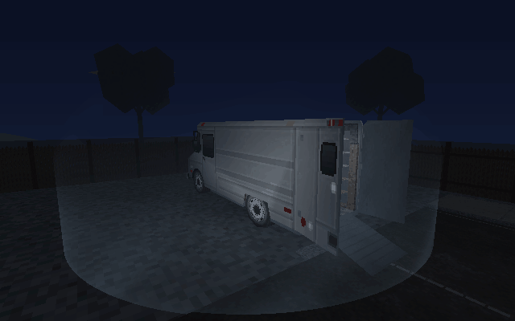
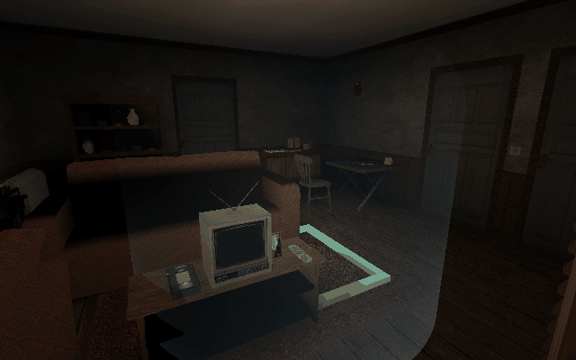

# Shared anti-ghost sanctuary material — 3 November 2026

The expedition van template carries a circular sanctuary centred on the complete vehicle, covering its loading ramp. A translucent light-blue energy haze rises to head height and joins a soft dome over the roof. Flowing world-space cloud layers and curling wisps animate continuously. The material fades throughout the wall, reaches 22% of its density at the wall/dome join, and falls to 0.2% at the crown; the join has continuous opacity and slope. The crown is almost clear. The same material identifies settled, live protective wards.

Castle Beckenburg has **one sanctuary around the entire headquarters**, including the courtyard, gate, upper rooms, cellar and west training annex. The parked Castle van has no individual barrier. Its inspection overview disables distance fog to expose the whole boundary; the courtyard capture uses the regular local view.

The radius and dome profile are shared with spectral exclusion. Host-controlled ghost steps are swept against the protected volumes, room transfers choose valid unprotected support, both Twins follow the exclusion, and protected physical Hunters cannot receive ghost contact/Frenzy damage. Hunters move freely through the haze. A ward gains the material and exclusion after landing and loses both at expiry. Airborne wards, ritual preparation that only reduces damage, and ordinary hiding pockets do not advertise full sanctuary protection. Original ward charges and expiry are retained.
The radius and dome profile are shared with spectral exclusion. Host-controlled ghost steps are swept against the protected volumes, room transfers choose valid unprotected support, both Twins follow the exclusion, and protected physical Hunters cannot receive ghost contact/Frenzy damage. Hunters move freely through the haze. A ward gains the material and exclusion after landing and loses both at expiry. Available cupboard and outdoor-refuge hiding locations now reuse the same animated material at the user's request,7November. Cupboard veils fit the open hiding pocket; outdoor refuge markers enclose the associated opaque refuge foliage so the cue remains visible. Existing enter/hide/crouch rules remain. Markers and ghost pocket exclusion follow the actual shared difficulty budget; disabled/inert sockets produce neither. Airborne wards and ritual preparation that only reduces damage retain their existing presentation. Original ward charges and expiry are retained.

The ghost receives atomic, bounded public barrier snapshots so it can see those same areas, including on view re-entry. These contain barrier coordinates, with no investigator positions, loadouts or private evidence. The existing optional Spiritual War presentation still consumes its authoritative sanctuary clock.

The shared compositing pass reads finished world/character depth in software and OpenGL frames. It remains transparent and never replaces the scene depth buffer. Three completed real OpenGL frames on the RTX 5070 verify the effect in the hardware renderer. The PNGs are actual runtime inspection captures, and both GIFs are assembled directly from twelve consecutive game-rendered frames at 180ms intervals.

Focused rules, ward lifecycle, ghost movement, collision/combat, all-site spawn, Twins, privacy and real four-peer TCP checks pass. The complete host/join/evidence/ritual/result/payout multiplayer round also passes. Logs and the GPU record are under `development/quality/evidence/safe-area-barrier-2026-11-03/`.

**House status:** these views use the currently dispatched House. `HouseRebuild.graybox()` and its basement/terrain-cutout verification remain separate from that dispatch path. This work does not claim the rebuilt House or its basement entrance has replaced the live House.
