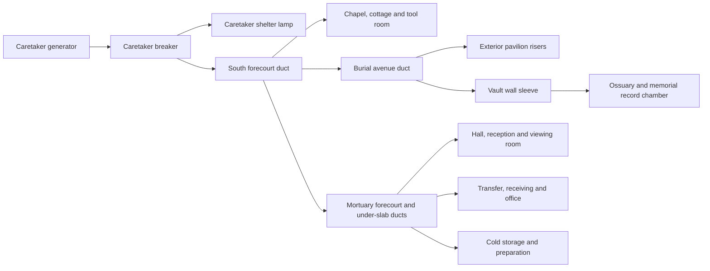

# Cemetery and Vale Mortuary electrical distribution

The caretaker board feeds the buildings from the existing service yard. Protected ducts follow surveyed forecourt and burial-avenue ground, with connections into founded buildings. The stair pavilions stand over the vault. Their feeds emerge outside and rise along the masonry to sealed service sleeves beside the existing doors. The vault has its own wall sleeve and a supported overhead feed to the ossuary and archive. The mortuary branches follow the founded slab and existing overhead partitions.

| Switch location | Switched fixtures |
| --- | --- |
| Chapel | Chapel |
| Caretaker cottage | Cottage |
| Tool room | Tool room |
| West stair pavilion | West stair pavilion |
| East stair pavilion | East stair pavilion |
| Ossuary | Ossuary |
| Memorial record chamber | Memorial record chamber |
| Mortuary visitor hall | Hall and reception |
| Mortuary viewing room | Viewing room |
| Mortuary staff transfer | Transfer, receiving bay and office |
| Mortuary cold storage | Cold storage and preparation |

The base map has seven switched lamps and the annex has fifteen lamps on eleven switches. The existing shelter light follows main supply. Both renderers replayed the current set of 44 supported routes in both directions and postures, 24 operating doors, and entry and exit checks for the three refuges on each map. Tests checked the output of every switched lamp, plus generator stop and breaker trip. Four-player LAN sessions toggled and restored the cottage and archive independently. The annex session also tested the cold-store and preparation switch. The separate caretaker scenario exercised the breaker trip, generator stop and restart, reconnect while tripped, and reset.

The current captures show rough interior finishes. Case furnishings, named mission selection, architecture and material review, and release acceptance remain open.

[Exact checkpoint](checkpoint.json) · [Cemetery software and LAN replay](wld-07/distribution-software.tsv) · [Annex software and LAN replay](wld-07-mortuary/distribution-software.tsv) · [Current roster](roster.json)
