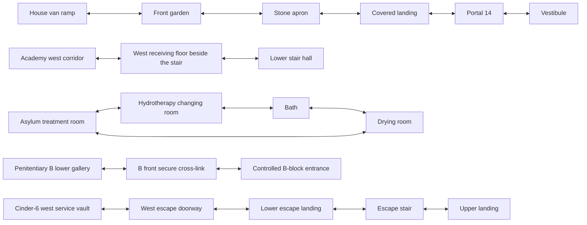

# Verified entrance and landing circulation

These sequences come from the saved floors, doors, and stair assemblies. Follow the links to see the actual supporting surfaces and openings. The paths are drafting guidance.

| Location | Measured plan | Swept path |
| --- | --- | --- |
| Briar House | [Porch plan and entrance section](house/porch-plan-section.svg) | [Yard, sill and van results](verification/house-runtime.json) |
| Academy | [West stair approach](academy/measured-plan.svg) | L40 |
| Asylum | [Hydrotherapy suite](asylum/measured-plan.svg) | L40 → L41 → L42 → L43 |
| Penitentiary | [B lower gallery approach](prison/measured-plan.svg) | L050 → reverse L078 |
| Cinder-6 | [Lower escape landing](wld-18/measured-plan.svg) | Route 08 through the frame and up the existing flight |

[Verified joined native journeys](verification/joined-journeys.json)
