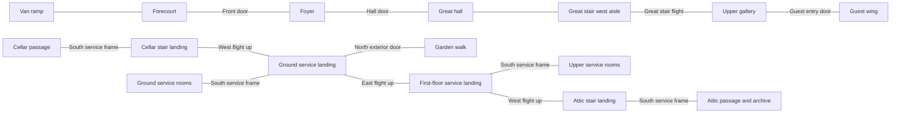

# Blackthorn Manor service stair and great stair

The masonry service bay spans X40–46 and Z2–14. Its four south thresholds stay on X41.5, Z14 at the cellar, ground, first-floor and attic datums. Each new 1.35 m clear service frame sits in a full replacement pier-and-lintel wall at the original thickness and height. The two central transfer aisles provide 1.16 m between fixed guards and slab rims. At the great stair, the west aisle leads south of the waist to the bottom landing. The upper guest route reaches the full receiving floor before turning around the well.

[Service-wing floor plans](service-wing-plans.svg) · [Native export inspection](export-verification.json) · [Joined native journeys](../verification/complete-journeys.json)

All floor plans use the existing slab outlines and well locations. Dashed routes are walking guidance derived from the physical floors, flights, guards and thresholds. The retained furnishings, terrain, van, protected rooms and runtime registration have their own source records. Shared gameplay rendering, collision and navigation, door state, acoustics, services and multiplayer evidence remain open.
