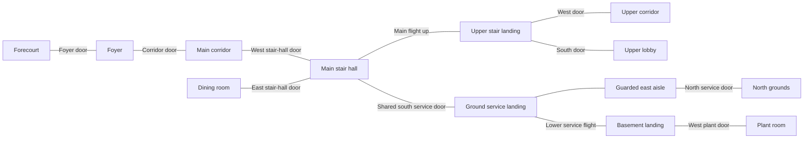

# Ravenshade School service stair

The service bay has a 300 mm ground slab spanning its full X27.2–30 by Z12–20 footprint. The rectangular well at X27.4–28.65 and Z13.3–18.3 follows the existing 1.20 m gross lower flight. The re-seated east and north guards border the well. The clear 1.02 m east aisle reaches the existing fitted north service door. A full receiving floor connects the head of the lower flight to the main stair hall through the south shared door.

The passage into dining clears the actual frame before turning between the east wall and the retained cafeteria table. The lower plant-room door, upper corridor and other pedestrian guidance follow their measured thresholds.

[Service bay plan and section](plan-and-section.svg) · [Native export inspection](export-verification.json) · [Joined native journeys](../verification/complete-journeys.json)

The diagram describes the verified physical connections. The native forecourt-to-plant walk starts at the exterior forecourt, and the separate vehicle-ramp arrival and shared gameplay runtime gates remain open.
