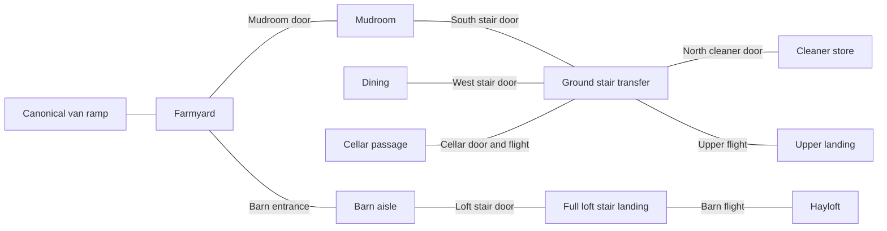

# Hollowmere Farm stair and loft approaches

The ground-floor transfer runs at X23.13 between the west well guard and the east stair guard. Their clear separation is 1.16 m. The mudroom, dining room and cleaner use their existing 1.05 m fitted doors. The route turns on full landings at both ends of the well.

The barn loft approach crosses the actual X39 threshold at Z17.50, then turns north in the 1.09 m aisle between the wall and the flight guard. The house, basement, loft and their terrain keep their saved structural assemblies.

[Measured plan](measured-plan.svg) · [Physical export review](export-review.json) · [Joined native walks](../verification/journeys-and-ramp-runtime.json)

The plan's dashed guides indicate movement through the supported floors and real frames. Shared investigation service and multiplayer evidence remains open.
