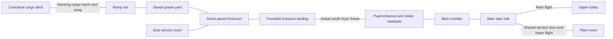

# Ravenshade School canonical arrival

The canonical van remains at X28, Y0, Z51 with its established orientation. The real ramp toe is X24.372, Y0, Z51. The route leaves the ramp squarely, crosses the existing gravel yard, joins the continuous south forecourt and enters through the 1.80 m fitted foyer sill at X22.5, Z36. The east grounds join that same forecourt. The revised guides use those physical surfaces and the existing foyer frame.

[Measured arrival plan](measured-plan.svg) · [Physical export review](export-review.json) · [Staged engine proof](../verification/ramp-runtime-proof.tsv)

The staged production movement replay covers standing and crouched return travel, all six van spawn-to-hatch approaches, a closed-cargo-hatch control and the actual arrival ownership changes. The 40 authored search spaces have separate physical reachability evidence. Site enclosure and discovery of any additional accessible space, movable building-door state, services, shared renderer review and multiplayer acceptance remain open.
