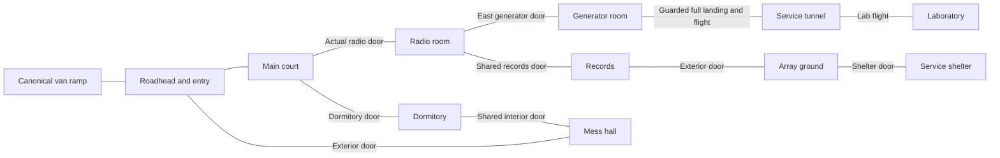

# Northwatch Research Station generator and door approaches

The generator approach crosses the room's actual east doorway at X20, Z19. The northward leg stays on the east side of the generator well guard, turns west on the full landing at Z16.05 and reaches the head of the existing tunnel flight. Dormitory-to-mess travel aligns with the shared doorway before crossing its jambs. The records, lab, store, mess and shelter approaches use the clear widths of their installed doors.

The outdoor arrival guide begins at the canonical rear ramp toe at X32, Z72.372. The radio-to-shelter walk uses the same outdoor array landing across both links.

[Measured plan](measured-plan.svg) · [Physical export review](export-review.json) · [Joined native walks](../verification/journeys-and-ramp-runtime.json)

The generator-room circulation uses the existing slab and well. Shared site identity, space ownership, services and network gates remain open.
