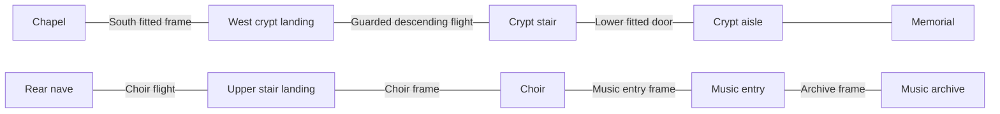

# St. Brigid Parish fitted approaches

The chapel approach crosses the 1.05 m crypt entrance at X28.50, Z26 and continues on the full floor west of the well. The west guard spans X30.45–30.53. The final turn runs parallel to the guard before joining the existing stair landing.

The vestry, consultation and confessional approaches align with their physical apertures before turning. The choir, archive and crypt links use their installed frame widths. The current wall, floor, well and stair models remain the physical source.

[Measured crypt plan](measured-plan.svg) · [Crypt threshold export review](export-review.json) · [Joined native walks](../verification/joined-review.json)

