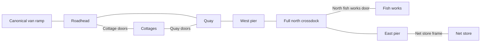

# Drowned Fisherman's Wharf crossdock and thresholds

The west and east pier guides turn at Z8 on the complete crossdock. The fish works north wall sits at Z10, so the turns stay on the deck outside both building corners. The fish works use their actual north door. The cottages use the installed 1.05 m frames, and the net store uses its 1.80 m opening.

The canonical ramp toe at X32, Z70.372 connects to the existing roadhead. Dock and building geometry, including the lower undercroft, retain their saved source bytes.

[Measured deck plan](measured-plan.svg) · [Crossdock export review](export-review.json) · [Joined native walks](../verification/joined-review.json)

