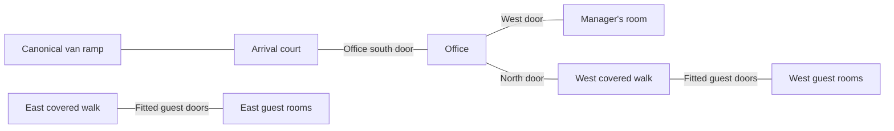

# Eight Pines Motor Lodge door approaches

The main office doors are 1.05 m clear at X18, Z50 and X18, Z42. The manager's room uses the fitted west office frame at X13, Z45. Each guest room is reached from its existing covered walkway through its own measured 1.05 m frame.

The entry guide begins at the canonical ramp toe at X26, Z64.372. The joined west-room sweep walks the full supported gallery between the office route and the selected guest door. The saved renderer and collision geometry supply all floors, sills, walls and frames.

[Measured office plan](measured-plan.svg) · [Manager's doorway review](export-review.json) · [Joined native walks](../verification/joined-review.json)

