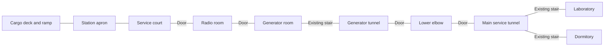

# Northwatch operating doors and room connections

Northwatch has sixteen operating frames on the existing shell. The leaves sit at the measured receiving faces of the reveals so opening them preserves usable doorway clearance. The lower tunnel remains on its original floor and stairs. Each leaf uses the same canonical model for render, collision, interaction and replicated state.

The review measured 144 supported positions at the frames and verified 15 connected, supported room owners. Software and OpenGL checked both leaf states, standing and crouched crossings, sight, object passage and room acoustics. Both renderers replayed the 20 retained links, three joined journeys and canonical van retreat. The four-player test started on the cargo deck, opened the actual courtyard and generator doors by aim, replicated both states and reached the generator floor.

Power, walk-in safe zones, named dispatch and the later acceptance gates remain open.

[Exact checkpoint](checkpoint.json) · [Software and LAN evidence](wld-08/doors-software.tsv) · [OpenGL evidence](wld-08/doors-opengl.tsv) · [Underlying perimeter plan](../northwatch-boundary-pass/wld-08/perimeter-plan.svg)
