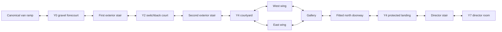

# Seacliff Battery receiving stairs and terraced approach

The saved grade supplies a broad Y0 gravel forecourt and a Y4 courtyard between the two wings. Each exterior flight has a full-width concrete stair on a buried sloping foundation, with anchored sidewalls. The intermediate Y2 court is a full 10.50 × 2.00 m cast landing. It sits in the surviving terrain and serves both flights. Gravel joins the upper stair head directly. The visible and physical scene now uses these complete assemblies in place of the old diagonal connector, thin yard strips and redundant end pads.

The original gallery wall now has a fitted frame at X30, Y4, Z26. The 1.50 m clear opening meets the protected lower reception floor. A 17-riser flight rises through a single rectangular opening in the closed Y7 director floor. Indexed guards mount on the exposed floor edges. Two lower concrete girders bear on the original casemate walls. Reopening the native export confirms all six beam-to-wall contacts.

The saved world retains the original terrain image and topology. All 737 saved opening checks pass. The three stair cells, fitted frame and ground use shared rendering and collision coordinates. The plan draws circulation from the canonical ramp, across both courts and wings, and through the real frame and supported director stair.

[Measured plan](receiving-plan.svg) · [Matched native and bearing review](visual-review.json) · [Staged gameplay evidence](../verification/battery-runtime.json)

## Verified staged circulation

The game mover reaches the director room from the van through both wings and returns through both, standing and crouched. All six cargo positions reach the hatch. The check verifies 14 supported room anchors, all three original ritual positions, the upper guard and the opaque roof. Staged host and guest snapshots agree on the leaf state. The closed frame blocks body, object and optical passage. The shared acoustic cost is 6 closed and 2 open. Matched game frames differ in 136,291 pixels.

Live site registration, the complete door and service schedules, ghost behavior, LAN transport and location acceptance remain open.
