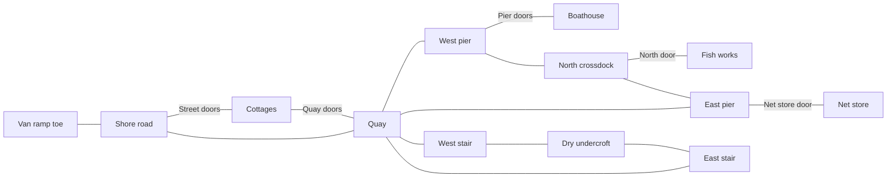

# Drowned Fisherman's Wharf foundations

Longitudinal pier joists and the crossdock frame bear on 156 retained driven piles. Each pile footprint was checked at its centre and four corners against the saved terrain. Thirty obsolete supports trace to old route guides in the prior construction ledger and were removed.

The north approaches to both stair cells and the south west-pier deck seat into the existing cast retaining walls through transfer girders. The cellar has two transverse grade beams below its slab. Each stair wing has two longitudinal grade beams below its foundation. Pile pairs carry the beams from intact ground beyond the excavation. The original stair cells and fitted door openings remain the basis of the layout.

The shared movement kernel walked all 18 links and three joined journeys in both directions, standing and crouched. All eight fitted frames have clear body passage and sightlines down the opening. The adjoining walls on both sides and the cellar slab and roof block the optical checks.

[Construction contacts](construction.json) · [Physics results](verification/physics.tsv) · [Checkpoint](checkpoint.json) · [Measured deck plan](../native-foyer-door-pass/wld-06/measured-plan.svg)

