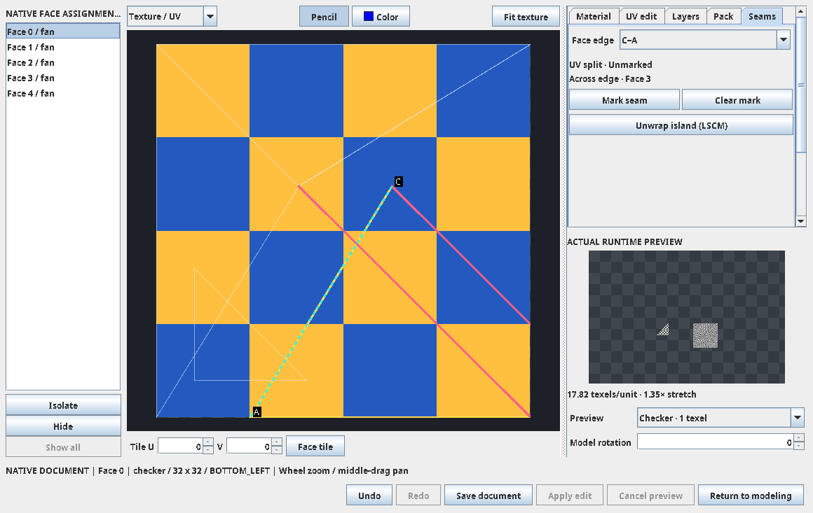

# Regional UV seam updates and glTF material export

## Selected edge in the Material Editor

The Seams tab highlights the chosen edge with cyan dashes. A paired edge identifies the adjacent native face and reports UV continuity independently of the authored mark. The desktop fixture marked two matching edges, moved the selected island, published it and checked every game UV. It canceled a pending clear, then applied the clear and confirmed the UV split persisted. Undo restored the initial matching UVs and marks. The regression also checks that the readout fits the panel and the selected edge appears on the UV canvas. [Desktop fixture](../../../../src/test/java/org/beckenburg/G2TexturedModelGuiTest.java)



## Material Editor face-list refresh

The first implementation exposed an independent stall in the Swing face list. On the same 120,000-face grid, a one-face preview removed the previous list and added one row at a time. The follow-up now reads immutable native faces directly, preserves selection by native ID and tells Swing which visible rows changed. Its regression covers sparse IDs, hiding, isolation, document replacement, reordering, font changes and selection callbacks. [Implementation 494a257c](https://github.com/mrcalzon02/The-Beckenburg-Project/commit/494a257c91c9f42afef40510581705b9d772c3fb) · [Face-list regression](../../../../src/test/java/org/beckenburg/editor/EditorMaterialRowsTest.java)

Medians below are from six samples after three warmups on Java 17 with a 256 MiB heap. The measured interval starts with an already prepared native snapshot and ends when the Material Editor returns from updating the UI on Swing’s event-dispatch thread. Screen painting and game rendering occur outside this interval. [All matched samples](material-rows-results.tsv)

| Operation | List events before → after | EDT allocation before → after | EDT time before → after |
|---|---:|---:|---:|
| Preview one visible face | 120,001 → 1 | 662,585,416 → 1,072 B | 601.44 → 1.47 ms |
| Cancel that preview | 120,001 → 1 | 662,585,504 → 1,176 B | 705.05 → 1.22 ms |

Editing a hidden face generated zero list events. Structural or filter changes can affect multiple rows. On a new snapshot the model still scans face references to identify changed rows.

### Visible workspace repaint

A separate Java 17 test opened the real Material Editor workspace in an 1100 × 700 Swing window on the same Xorg 21.1.16 virtual display for both revisions. All 120,000 untextured triangles fit in one UV tile. The UV canvas measured 576 × 566 pixels and the face list showed 24 rows. Both runs used two warmups and five measured pairs. The workspace used empty settings, runtime and command panes. [Raw showing-window samples](material-window-results.tsv)

| Median time including a synchronous full workspace repaint | Before | After |
|---|---:|---:|
| Preview one face | 900.2 ms | 231.7 ms |
| Cancel that preview | 868.5 ms | 279.7 ms |

On the new revision, a separate UV-only repaint took a median 191.7 ms on preview. A list-only repaint took 3.7 ms. Each measurement repaints its region separately. The UV canvas still visits every visible triangle and draws its outlines on a full repaint. DEV-362 tracks this remaining cost. These timings apply to the virtual display and fixture.

## Mesh allocation

A Material Editor UV shift on one interior triangle changes three seam flags and their twins. The native topology now shares unchanged 256-entry half-edge pages between immutable revisions. A full rebuild still computes all connectivity and diagnostics. The Java 17 regression places 347 twin pairs 1,042 edge entries apart, branches dense and partial edits and compares all five retained snapshots against independent rebuilds. The same test class exercises 120,000-face meshes under a 256 MiB heap.

The allocation fixture uses 120,000 connected triangles and 60,501 vertices. It alternates a 0.125 UV shift on one interior face and verifies the UV and seam results at each iteration. Mean calling-thread allocations below are bytes over eight samples after four warmups, using Temurin 17.0.21+9 and a 256 MiB heap. The isolated topology call repeats the update separately and falls outside the complete edit measurement.

| Operation | Vertex and face IDs | Baseline | Regional pages |
|---|---|---:|---:|
| Isolated half-edge update | Ordinal | 5,760,400 | 8,072 |
| Isolated half-edge update | Sparse 64-bit | 5,760,400 | 8,072 |
| Create, review, apply and read back the edit | Ordinal | 9,610,828 | 3,858,488 |
| Create, review, apply and read back the edit | Sparse 64-bit | 23,070,328 | 17,318,004 |

The sparse fixture uses descending vertex IDs above 2⁴⁰ and face IDs above 2⁴³, with gaps. Its candidate validation still builds ID indexes. These measurements cover authoring-thread allocations and exclude GPU uploads and frame presentation. [All samples and phase breakdowns](allocation-results.txt)

## Interchange

Khronos glTF Validator 2.0.0-dev.3.10 examined 21 files per revision. Twelve exports exercise OPAQUE, BLEND and MASK materials in both GLB and JSON glTF, using either a new mesh or a material added to an imported model. Both sides use the same 1,996-byte source GLB for that comparison. Nine additional files cover float, unsigned-byte and unsigned-short UV inputs, followed by a native edit, save, reopen and export to both formats.

| Validator result across 21 files | Baseline | Updated export |
|---|---:|---:|
| Errors | 0 | 0 |
| Warnings | 17 | 0 |
| Informational messages | 120 | 120 |
| Hints | 156 | 156 |

Every baseline warning identified an `alphaCutoff` written for an OPAQUE or BLEND material. New exports emit the glTF property for MASK and preserve native cutoffs through Beckenburg metadata. Existing third-party source material definitions retain their original fields. Remaining notices include retained unused buffers, view targets and private extension metadata. [Per-file diagnostics](validator-results.tsv)

## Verification on implementation 8173f2ed

The Java 17 build compiled all 493 production sources and 634 test sources. The standalone kit also compiled independently of the host. All 69 portable checks and 31 host checks passed locally, followed by the windowed G2 textured-model regression. [Local command results](local-acceptance.txt)

The Windows standalone job compiled the portable kit and passed the cross-page adjacency and alpha-mode cases. Its downloaded JAR passed both suites independently with a 256 MiB heap. [Standalone run](https://github.com/mrcalzon02/The-Beckenburg-Project/actions/runs/43976139396)

The Windows native and installed-editor job passed the same GUI fixture, editing and saving through the installed executable, reopening, renderer capture and game readback. Its 219-file artifact includes the seam inspector with face 0 selected and face 3 across edge C–A. [Native and installed editor](https://github.com/mrcalzon02/The-Beckenburg-Project/actions/runs/43976139586) · [Windows captures and logs](https://github.com/mrcalzon02/The-Beckenburg-Project/actions/runs/43976139586/artifacts/14281194455)

The Windows shipping job published the installer, editor kit and checksums at version 0.1.332. [Release](https://github.com/mrcalzon02/The-Beckenburg-Project/releases/tag/beckenburg-v0.1.332) · [Shipping checks](https://github.com/mrcalzon02/The-Beckenburg-Project/actions/runs/43976139475)

The Windows multiplayer job passed the packaged TCP round, gear pickup, van extraction and sound/voice checks. Its broad regression manifest logged 97 completed passes out of 379 entries before a newer push superseded the job. [Multiplayer run](https://github.com/mrcalzon02/The-Beckenburg-Project/actions/runs/43976139517)

## Verification on implementation 494a257c

A clean Java 17 build compiled all 493 production sources and 635 test sources. All 70 portable checks and 31 host checks passed locally. The windowed G2 fixture separately passed selected-edge inspection, visibility controls, native editing and game readback. The Windows standalone job passed; the row regression also passed against the JAR downloaded from that run. [Local checks](face-list-local-acceptance.txt) · [Standalone Windows run](https://github.com/mrcalzon02/The-Beckenburg-Project/actions/runs/43978423365)

The Windows shipping job installed the executable, started the game and reached Castle home. Release v0.1.333 points to 494a257c and includes the installer, independent Java 17 editor kit and checksums. [Windows release](https://github.com/mrcalzon02/The-Beckenburg-Project/releases/tag/beckenburg-v0.1.333) · [Shipping run](https://github.com/mrcalzon02/The-Beckenburg-Project/actions/runs/43978423373)

The release JAR matched the published SHA-256 `1203032a36901d62017014cc48419032b3aae933e02863ebd38a327685734148`. Its 423 file entries, including all 419 compiled classes, were byte-identical to those in the standalone runner’s JAR. The archive timestamps differed. The row, native mesh update and glTF authoring regressions passed independently against the released JAR with a 256 MiB heap.

The Windows native/installed-editor and full multiplayer jobs also run on the same implementation. [Native and installed editor](https://github.com/mrcalzon02/The-Beckenburg-Project/actions/runs/43978423378) · [Multiplayer and broad regression](https://github.com/mrcalzon02/The-Beckenburg-Project/actions/runs/43978423376)

## Reproduce

The script compiles [baseline f17b806c](https://github.com/mrcalzon02/The-Beckenburg-Project/commit/f17b806c0ed43d30d9ed250582543e7bbaeec0c6) and [implementation 8173f2ed](https://github.com/mrcalzon02/The-Beckenburg-Project/commit/8173f2edb367da3b602eb045080c90a855fc3441) from their Git objects. Run from a checkout containing both revisions with a Java 17 JDK on PATH. The original before-side validator run used `19161b70157f4f72e865c74cce507776526fa3ff`. Its portable editor sources and the two fixture classes are byte-identical to the benchmark baseline.

```sh
sh development/quality/evidence/editor-regional-seams-2026-11-16/run.sh allocation
sh development/quality/evidence/editor-regional-seams-2026-11-16/run.sh gltf
sh development/quality/evidence/editor-regional-seams-2026-11-16/run.sh rows
sh development/quality/evidence/editor-regional-seams-2026-11-16/run.sh window
```

The rows and window modes compare 8173f2ed with 494a257c. Window mode requires an accessible desktop display for both runs. The allocation mode checks numeric and full-rebuild parity in separate JVMs. Small JVM-dependent differences in measured bytes can occur. The glTF mode also requires Node.js, checks the SHA-256 of the pinned official validator package and compares all 42 severity rows and warning locations against the saved evidence. For offline verification, pass the existing validator `.tgz` as a second argument after `gltf`. Set `GLTF_REPORT_DIR` to retain the complete official reports.
