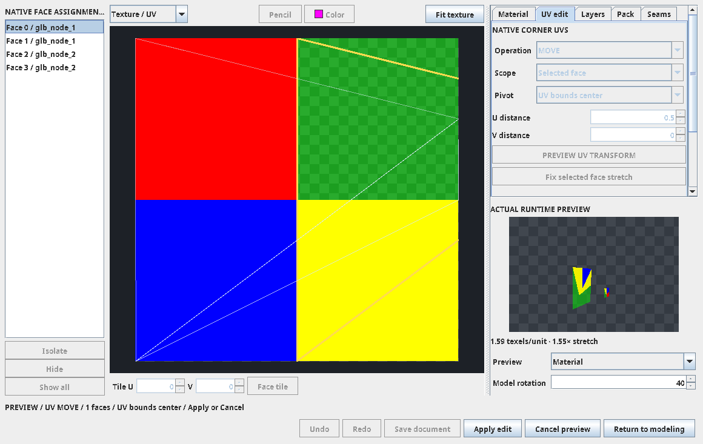

# Model Editor UV review and apply

[Implementation fb260c38](https://github.com/mrcalzon02/The-Beckenburg-Project/commit/fb260c38177489f9ff075dd5013de3d6253a5e17) compared with parent f3374fe4.

## Human workflow

A user previews a face or island UV edit in the Material Editor, inspects the result and clicks Apply. The Model Editor reuses the displayed mesh and adjacency when the project, immutable state and revision match. Undo, redo, cancel and intervening edits retain the existing native history checks. Selected-face binding, stretch correction and UV transforms supply their face ordinals for preview. Topology-changing operations retain full rebuild fallbacks.

The game and editor now decode normalized unsigned-byte and unsigned-short TEXCOORD_0 accessors. Tests cover interleaved attributes, nonzero offsets, invalid normalization and truncated buffers. Native editing, save and reopen, GLB/JSON glTF export and game readback preserve the reviewed UVs, source PNG and untouched instance. Untouched GLB export preserves the original bytes.

The official Khronos glTF Validator 2.0.0-dev.3.10 reported zero errors across nine files, covering 8-bit, 16-bit and float source GLBs and their edited GLB and JSON glTF exports. All nine share the same existing material warning because the generated BLEND material carries a mask-only alphaCutoff (DEV-359). Private Beckenburg extensions are checked by the native roundtrip tests. [Validator counts and diagnostic codes](gltf-validation.json)

The Java 17 desktop checks used the actual Model and Material Editor windows. The textured box retained 8 vertices, 6 authored quads, 12 triangles and 36 runtime corners after editing and interchange. The packed-UV test applied and canceled previews, changed a vertex, exercised undo/redo and published a model read back by the game. The image below is the selected face during a UV preview on the 16-bit GLB fixture.

## Allocation measurement

The harness uses HotSpot ThreadMXBean on Java 17.0.21+9 with a 256 MiB heap. It alternates a 0.125 UV shift on one interior face of a connected 120,000-triangle grid with 60,501 vertices. The phases cover candidate validation, mesh and bounds preparation, and history apply plus readback. Eight samples follow four warmups. Every iteration checks the UVs and the three affected paired seams. The final immutable mesh and topology are compared with an independent full derivation outside the measured interval.

| Calling-thread allocation, mean bytes per edit on ordinal IDs | Parent | fb260c38 |
|---|---:|---:|
| Construct and validate the candidate | 30,520,936 | 1,922,080 |
| Derive the reviewed geometry and bounds | 69,305,672 | 7,688,668 |
| Apply and read back mesh and topology | 12,104,992 | 80 |
| **Total** | **111,931,600** | **9,610,828** |

[Parent samples](before-results.txt) · [Implementation samples](after-results.txt)

A second fixture uses descending 64-bit vertex and face IDs with gaps. On that fixture the full operation fell from 112,382,088 to 23,070,332 bytes (79.5%). Its candidate validation still allocates 15,381,596 bytes on average to check arbitrary ID bindings. Both revisions passed the same UV, seam and final full-rebuild comparisons. [Sparse-ID samples](sparse-results.txt)

Run `sh development/quality/evidence/editor-reviewed-mesh-2026-11-16/run.sh` from a checkout containing both revisions with a Java 17 JDK on PATH. Append `--sparse` for the nonordinal fixture. The script compiles each published revision separately.

The 91.4% reduction covers Java authoring-thread allocations. Rasterization, input-to-display latency and GPU uploads were outside the measurement. Native snapshot validation still visits faces. A seam flag change still copies the flat half-edge list, even when only a few entries change. That copy is a bounded next target for G2.

## Published binaries

[Windows installer v0.1.330](https://github.com/mrcalzon02/The-Beckenburg-Project/releases/tag/beckenburg-v0.1.330) and its tag resolve to fb260c38177489f9ff075dd5013de3d6253a5e17. The installed executable, multiplayer smoke and external updater passed in the [Windows shipping run](https://github.com/mrcalzon02/The-Beckenburg-Project/actions/runs/43970011459).

The published Java 17 editor kit was downloaded and its SHA-256 matched the release digest, `c22be73db1a97c1123631716a3d3eea7254933bb14ea4a073e1956252f63f1fd`. All 417 class entries passed ZIP integrity inspection. EditorMeshUpdateTest, EditorMeshPipelineTest, EditorTopologyProjectTest and EditorGlbAuthoringTest were compiled against the release JAR and passed with a 256 MiB heap, with only that JAR and the test classes on the runtime classpath.

## Windows acceptance and full regression coverage

- The [standalone Windows job](https://github.com/mrcalzon02/The-Beckenburg-Project/actions/runs/43970011593/job/133659374351) passed the mixed edits, maximum fixture and normalized UV roundtrips and produced the [portable kit artifact](https://github.com/mrcalzon02/The-Beckenburg-Project/actions/runs/43970011593/artifacts/14277699156).
- The [native Windows editor job](https://github.com/mrcalzon02/The-Beckenburg-Project/actions/runs/43970011401/job/133659373325) passed including the installed executable's Castle repair and material-layer edit, save/reopen, render and game readback. Its [218-entry evidence archive](https://github.com/mrcalzon02/The-Beckenburg-Project/actions/runs/43970011401/artifacts/14280705031) was downloaded and checked. It contains native files, interchanges and actual editor and game frames. The optional Ollama pilot was skipped on this push.
- The [packaged multiplayer job](https://github.com/mrcalzon02/The-Beckenburg-Project/actions/runs/43970012161/job/133659378241) passed the required TCP, dropped-gear, extraction and ghost-hearing checks. Its broad manifest recorded 338 passes before a newer main commit superseded the job during test 339. On Linux, the remaining 40 tests passed separately at the same source with release assets, Java 17 and the repository timeouts. All 378 entries have a recorded pass across the two platforms. [Build, preflight and 40 test transcripts](linux-manifest-339-378.txt).
- The prior G2 source 2ea6f0ac also completed all four previously pending Windows runs. Its standalone and native editor workflows passed, its full manifest reached 378 passes in one Windows run, and the installer published v0.1.329.
