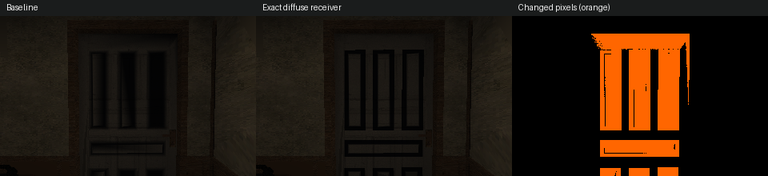

# House door 2 on Mesa

The RGB upload candidate reduced the bytes sent for the 18 revised resident resources from 401,856 to 150,696 on each door toggle. All 116 complete 320 × 200 OpenGL ARGB and raw-depth captures matched the unmodified renderer. The first toggle in each cold process also uploaded 71,616 bytes for two other batches in every arm. The measured difference on **each of the 48 toggle frames per arm** was 251,160 bytes.

The upload candidate stores XYZ and UV ahead of the contiguous RGB region of each positive-ID resident VBO. It keeps an owned CPU snapshot of the geometry (20 bytes per resident vertex). It compares all five geometry fields against the last real upload on a changed revision, including when the caller recycles the same source array. A matching revision or draw-only descriptor needs no retransmission. Dynamic batches retain the existing interleaved Mesh path.

## Timing

House door 2, settled alternating poses and fixed camera. Each arm ran twice in a fresh Java 17 process, 58 frames per run, with 24 timed toggle frames. Order was baseline, receiver-only, RGB-only, both, both, RGB-only, receiver-only, baseline. Each used a 420 MiB Java heap cap, two visible JVM processors, Serial GC, two Mesa worker threads and the same CPU affinity on shared Linux. llvmpipe 25.0.7 rendered the frames. Results below pool each arm's 48 toggles and use nearest-rank percentiles. A shared host killed two attempts during other workloads. The completed retries used fresh processes and are the only observations in the table. Partial CSVs are preserved in the archive.

| Isolated change | Render-thread CPU p50 / p95 / p99 (ms) | GL draw-issue wall p50 / p95 / p99 (ms) | Synchronous end-to-end p50 / p95 / p99 (ms) | End-to-end >100 ms |
| --- | --- | --- | --- | ---: |
| Baseline | 75.42 / 154.64 / 307.81 | 13.16 / 31.35 / 84.97 | 140.39 / 264.72 / 454.04 | 48 |
| Receiver reuse | 53.15 / 75.83 / 229.41 | 13.04 / 18.00 / 38.71 | 94.63 / 174.79 / 306.75 | 19 |
| RGB upload | 81.15 / 147.69 / 265.00 | 13.14 / 20.63 / 47.49 | 160.23 / 327.80 / 382.14 | 48 |
| Both | 52.29 / 80.75 / 225.74 | 13.19 / 19.46 / 20.52 | 91.98 / 139.17 / 285.21 | 16 |

Mesa showed a bandwidth reduction and a slower median synchronous completion for the RGB-only variant in these trials. Its render-thread CPU path is the same as baseline. GL timing includes driver work and synchronization. Gameplay cadence and physical graphics hardware require separate trials.

## Receiver experiment and shadow boundary

The receiver-only experiment shares an immutable probe within the current resident rebuild for vertices with the same material, exact XYZ, room and normal. It matched all reference frame hashes and reduced median render-thread CPU on this route. A more sensitive fixture exposed a pre-existing error in both the unmodified renderer and the memoized candidate.

The saved doorway samples in room 1 are 23 mm apart. With door 2 open, source 0 is occluded at A and visible at B. A fresh lookup gives red 0.9766000 at A and 1.0767660 at B. The test feeds A,B,B,A and B,A,A,B through the production prepared-vertex builder. It keeps the same stationary-shadow archive through closed, open, closed, reopened states and compares each stored float with a new lighting field for that precise point. Four of eight ordering/pose cases fail on baseline and receiver-only. When A comes first, B reports 0.9905047 on open and reopen. When B comes first, A reports 1.0646204. The older diffuse visibility lookup rounds both receivers into the same cell, even though the CPU experiment creates two different probes.

An alternative exact world-coordinate key in the retained diffuse-shadow lookup passed all eight ordering/pose tests. It changed 56 of the 58 full color frame hashes and zero depth hashes. This fixture establishes the correction at the measured boundary. Across 3,712,000 frame-pixels, 406,960 changed RGB (10.96%). The per-frame changed count ranged from zero to 13,245 of 64,000, with a median of 7,456. The maximum absolute channel difference reached 49 of 255. The mean absolute channel difference was 1.131 across all pixels and 10.313 across changed pixels. Alpha matched everywhere. The frame with the most changed pixels shows the effect across the face of the door. This reaches well beyond the two receivers, and the corrected-key variant remains under review. The receiver experiments are archived independently of the upload code.

[Per-frame pixel differences](pixel-differences.csv) · [Raw baseline and corrected ARGB buffers](door-pixels.zip). The archive stores each distinct 320 × 200 frame once in top-to-bottom A,R,G,B byte order under its SHA-256. The included CSV maps every view to its two complete buffers and raw-depth hash.

The GL frames also cover door 3, window 19, near-plane geometry, lamps, UV and restoration of prior poses. The combined route using the pre-existing visibility rules matched all 72 recorded software RGB/raw-depth hashes against both baseline and candidate in the earlier checkpoint. A separate smoke ran on two newly created GL contexts and exercised a draw-only descriptor, RGB revision, recycled-array geometry revision, resize and scene replacement. Its synthetic triangle changed 19,492 rendered pixels while preserving depth on the RGB update. The six lighting/door/depth contracts and GL context logs accompany the traces.

## Reproduction and raw data

[Raw frame CSVs, per-file hashes and logs](door-frames.zip) · [Unshipped receiver and exact-shadow patches](receiver-experiments.zip) · [GL test route](DoorGlReview.java) · [Prepared receiver oracle](DoorReceiverReview.java) · [Fresh doorway visibility witness](DoorwayShadowWitness.java)

Run `python3 verify.py` beside the ZIP. With the earlier checkpoint's `benchmark-data.zip` in the parent directory, the verifier also checks all software hashes. The baseline was built from the renderer at `c41bc66c9e09d0118012de748761b57a99bc5f53`. For new measurements build the Java 17 game and GPU client with their original resources and libGDX/LWJGL libraries. Compile the enclosed Java probes against that classpath. Run `org.beckenburg.DoorGlReview path/to/frames.csv` on a desktop with OpenGL 3.3. Run `org.beckenburg.DoorReceiverReview` for the baseline witness or pass `--memo --require-exact` for the corrected experiment. Each receiver CSV row records pose ordinal, door open, reversed insertion order, oracle match, actual RGB float bits and reference bits. Each four-vertex stream contains two positions and two duplicates.
